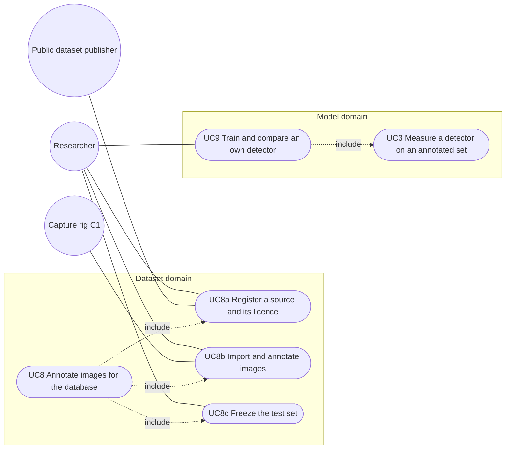

# Use-case diagram — annotation-pipeline

> **Feature**: annotation-pipeline (issue #95) · **Spec**: [annotation-pipeline](../../specs/annotation-pipeline.md)
> **Related ADRs**: ADR-0015, ADR-0018 to ADR-0022

## Context

UC8 is refined into three actor goals. Hashing, class mapping and leakage checks are system
behaviour inside them, not use cases. UC9 includes UC3 (score on the frozen set).

## Diagram

## Notes

- The publisher and C1 are secondary actors: they supply images and metadata, they initiate nothing.
- UC8c happens once per test-set version (`test-v1` public, `test-v2` adds field groups).
