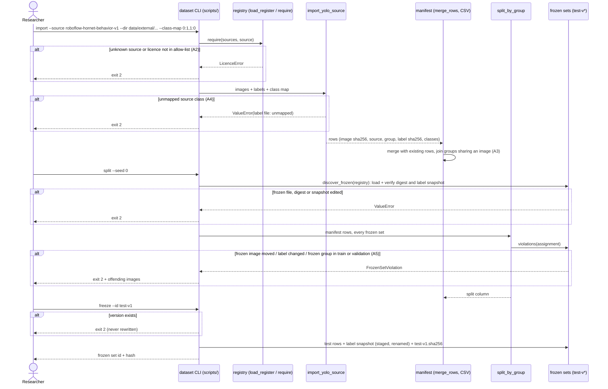

# Sequence diagram — import, split, freeze

> **Feature**: annotation-pipeline · **Spec**: [annotation-pipeline](../../specs/annotation-pipeline.md)
> (main scenario steps 1–5, A2, A3, A4, A5) · as built in PR 2 (`scripts/dataset.py`)

