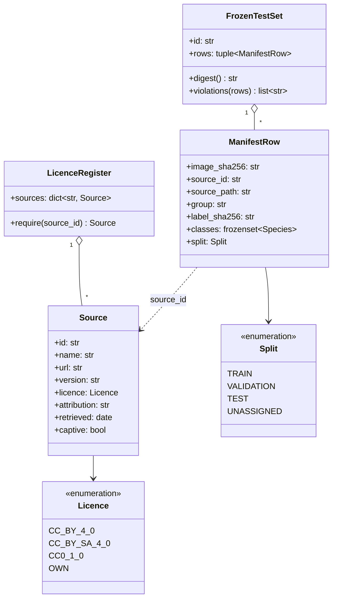

# Class diagram — dataset module

> **Feature**: annotation-pipeline · **Spec**: [annotation-pipeline](../../specs/annotation-pipeline.md)

## Context

Stdlib-only code in `src/aristech/datasets/` (beside `distribute.py`), like `evaluation/`: an
offline tool, not runtime detection, so no port (no second implementation, ADR-0010). It reuses
the domain `Species` for the four classes (`UNKNOWN` = "other"). Training lives outside the
package (ADR-0022).

## Diagram

## Notes

- `split_by_group(rows, seed, ratios, frozen)` and `group_for_capture(metadata)` are functions,
  not classes (KISS).
- Licence ids follow SPDX.
