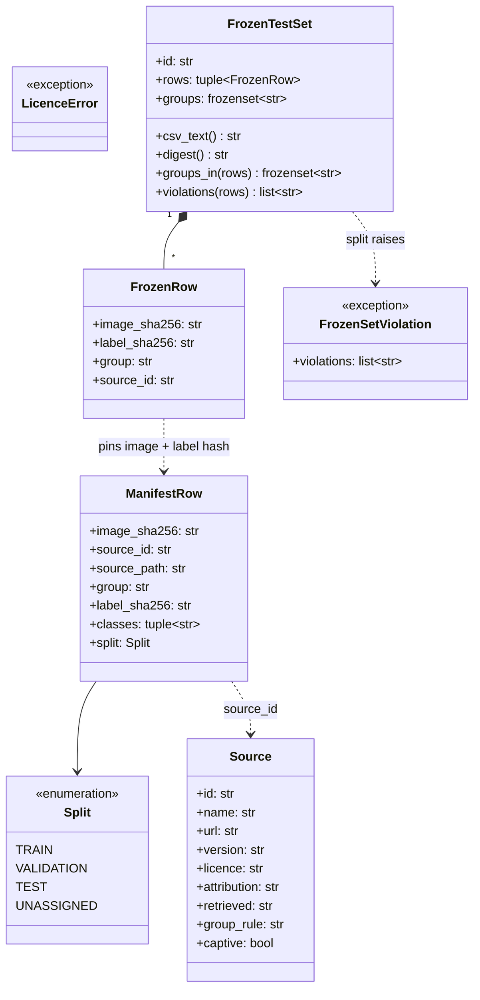

# Class diagram — dataset module

> **Feature**: annotation-pipeline · **Spec**: [annotation-pipeline](../../specs/annotation-pipeline.md)

## Context

Stdlib-only code in `src/aristech/datasets/` (beside `distribute.py`), like `evaluation/`: an
offline tool, not runtime detection, so no port (no second implementation, ADR-0010). It reuses
the domain `Species` for the four classes (`UNKNOWN` = "other"). Training lives outside the
package (ADR-0022).

## Diagram

## Notes

- As built (PR 2, 2026-10-22). The register is `load_register(path) -> dict[str, Source]` plus
  `require(sources, id)` raising `LicenceError`; the licence is an SPDX string checked against
  `ALLOWED_LICENCES` (no enum class: one allow-list, KISS). `group_rule` (`stem` | `video` | `observation`) says
  how `group_key` derives an image's group.
- `classes` holds canonical class names (`CANONICAL_CLASSES`, ADR-0018), `other` =
  `Species.UNKNOWN`.
- Functions, not classes (KISS): `import_yolo_source`, `merge_rows` (union-find group join),
  `group_key`, `group_for_capture`, `read_manifest` / `write_manifest`, `split_by_group`,
  `freeze`, `load_frozen`, `discover_frozen`, `export_yolo_view` (PR 4, AC11).
- PR 4 adds `RFDETRDetector` in `infrastructure/vision/`, the second `HornetDetector` adapter
  (ADR-0024). It lives outside this module: `detect(frame) -> Sequence[Detection]`, the model's
  class names mapped to `Species`.
