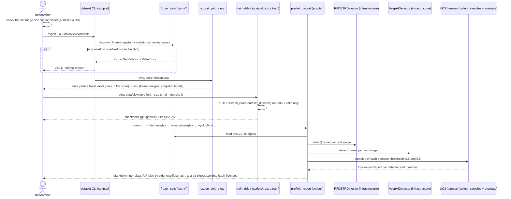

# Sequence diagram — export, train, score (UC9 + UC3)

> **Feature**: annotation-pipeline · **Spec**: [annotation-pipeline](../../specs/annotation-pipeline.md)
> (main scenario step 6, AC5, AC7, AC8, AC11) · **ADR**: ADR-0022, ADR-0024 · PR 4

## Notes

- The report never reads `train/` or `valid/`: only the frozen set's own folder.
- Both detectors run at the lowest threshold once; every threshold is scored from the same
  samples (as in the M3 report).
