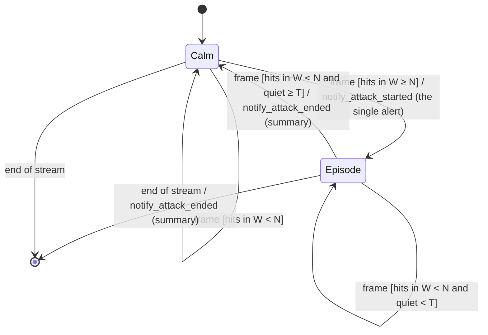

# State diagram — attack-alert — attack episode lifecycle

> **Feature**: attack-alert (issue #149) · **Spec**: [attack-alert](../../specs/attack-alert.md) ·
> **ADRs**: ADR-0014, ADR-0031

## Diagram

## Notes

- A *hit* is a frame with at least one *V. velutina* at or above the COUNT point; other species and
  boxes below the COUNT point never count (AC2).
- *quiet* is the time since the last frame that had pressure; `N`, `W`, `T` come from the `alert`
  section of the configuration (AC3).
- No transition sends an alert while in *Episode* (AC1, AC5).
- Implemented by `application/attack_episode.py` (`AttackEpisodeTracker`).
