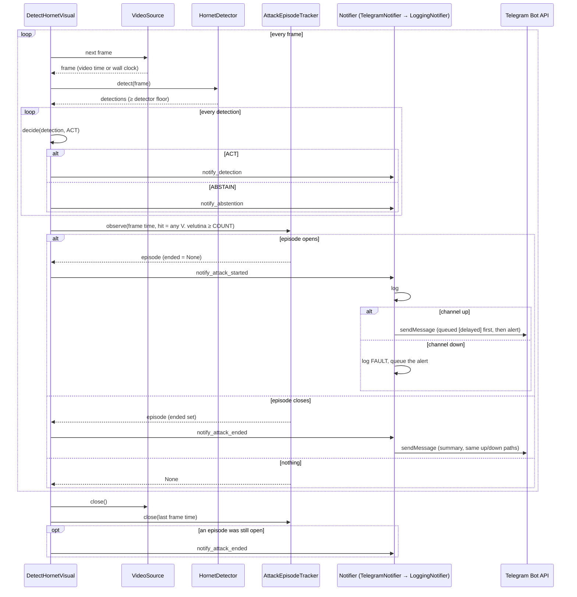

# Sequence diagram — attack-alert — one alert per episode in the live loop

> **Feature**: attack-alert (issues #149, #152) · **Spec**: [attack-alert](../../specs/attack-alert.md) ·
> **ADRs**: ADR-0009, ADR-0031, ADR-0032

## Diagram

## Notes

- Detections and abstentions are only logged, never sent to `P` (AC5). A channel failure never
  raises into the use case (A3, AC8).
- The ACT / ABSTAIN path is unchanged (ADR-0009); the episode path only reads the same detections.
- The detector floor must not exceed the COUNT point, or counted boxes would never reach the use
  case; the CLI enforces `floor ≤ COUNT ≤ ACT`.
