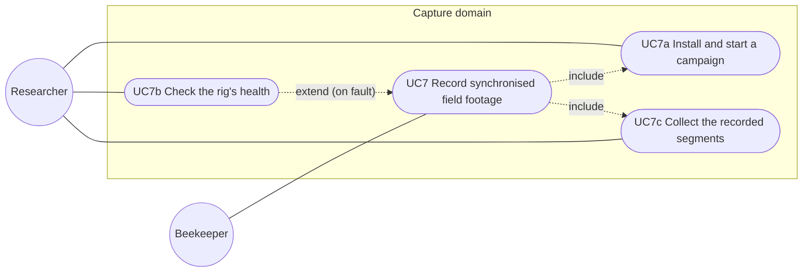

# Use-case diagram — capture-rig

> **Feature**: capture-rig (brick C1) · **Spec**: [capture-rig](../../specs/capture-rig.md)
> **Related ADRs**: ADR-0015, ADR-0016, ADR-0017

## Context

The capture rig serves one actor-initiated goal, UC7, refined into its sub-goals. Motion
triggers, the daylight window and the disk watchdog are system behaviour inside UC7, not use cases.

## Diagram

## Notes

- UC7b reads the fault log and the last sidecars (home: over Wi-Fi; remote: at the visit).
- The Beekeeper only hosts the rig (secondary actor).
