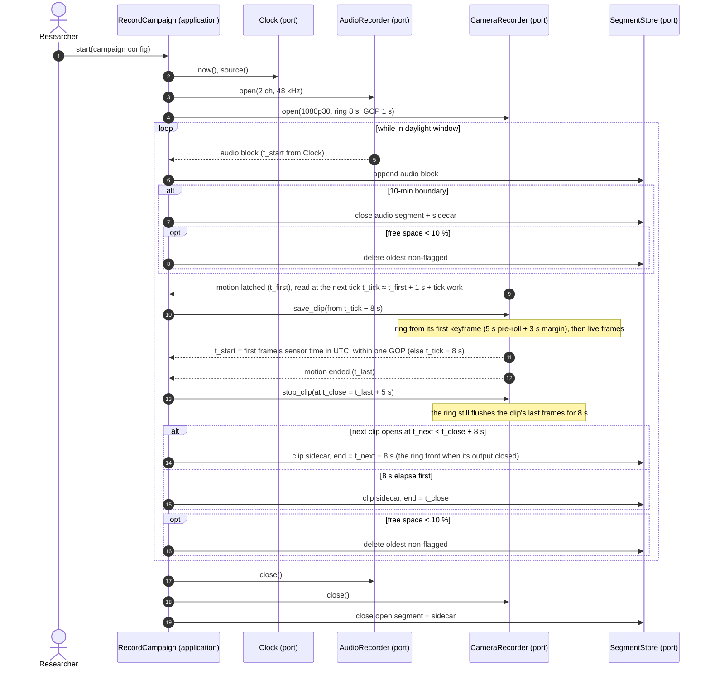

# Sequence diagram — capture-rig — synchronised recording

> **Feature**: capture-rig (brick C1) · **Spec**: [capture-rig](../../specs/capture-rig.md)
> **Related ADRs**: ADR-0017

## Context

One daylight window: both audio channels stream continuously; video frames fill a RAM ring
buffer and a motion event saves pre-roll + live frames. Segment times come from the device where
it knows better (audio sample times, a clip's first-frame sensor time), otherwise from the
`Clock`; all are UTC wall time, which is what makes AC1 testable.

## Diagram

## Notes

- The free-space check runs after every closed audio segment and every stored clip, so audio
  alone (no motion) still triggers rotation (spec A1).
- A closed clip's sidecar waits one ring: if the next clip opens sooner (motion back within 8 s,
  or the 5 min cap during continuous motion), the camera closes the old file where the new one
  opens: the old file ends at the ring front, `t_next − 8 s` (#178), and the frames up to the new
  clip's first keyframe, `t_start`, are in neither file (a gap under one GOP). A fault
  or the end of the window during that ring changes nothing; releasing the camera (`close()`)
  drops the ring at once, so there the clip ends 8 s before the release (#180).
- A clip starts on the first keyframe old enough to leave the ring, up to one GOP (1 s) after
  `t_tick − 8 s`; the camera reports that frame's sensor time (CLOCK_BOOTTIME) mapped to UTC, so
  the sidecar matches the file to within the boot-to-wall mapping, not the GOP (AC1, #179). The
  tick waits up to 1.2 s for it (one GOP and a few frames); if it is unknown or outside
  `[t_tick − 8 s, t_tick]`, the sidecar falls back to `t_tick − 8 s`. libcamera documents the
  sensor time as CLOCK_BOOTTIME; the Pi never suspends, so it equals CLOCK_MONOTONIC there.
- Fault branches (mic, camera, disk) are in the [state diagram](04-state.md).
