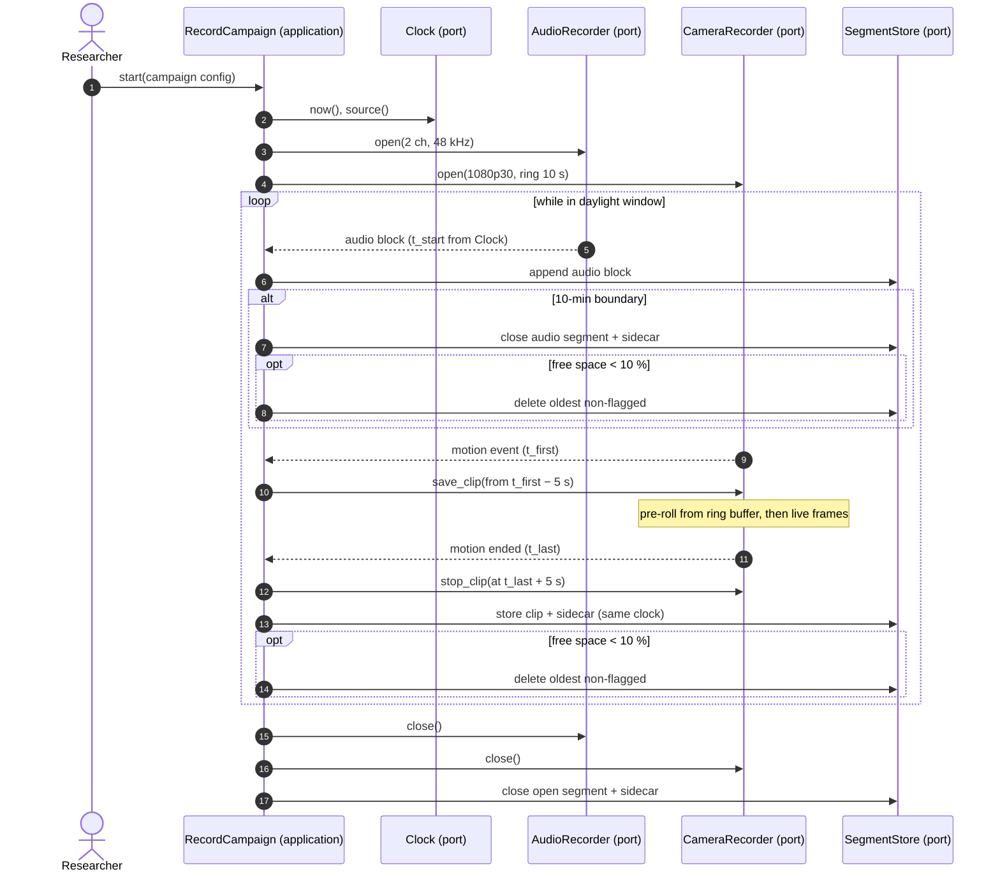

# Sequence diagram — capture-rig — synchronised recording

> **Feature**: capture-rig (brick C1) · **Spec**: [capture-rig](../../specs/capture-rig.md)
> **Related ADRs**: ADR-0017

## Context

One daylight window: both audio channels stream continuously; video frames fill a RAM ring
buffer and a motion event saves pre-roll + live frames. Every timestamp comes from one
`Clock` (monotonic, mapped to UTC once per segment), which is what makes AC1 testable.

## Diagram

## Notes

- The free-space check runs after every closed audio segment and every stored clip, so audio
  alone (no motion) still triggers rotation (spec A1).
- Fault branches (mic, camera, disk) are in the [state diagram](04-state.md).
