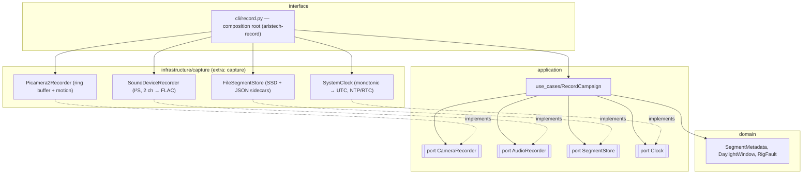

# Component diagram — capture-rig

> **Feature**: capture-rig (brick C1) · **Related ADRs**: ADR-0001, ADR-0010, ADR-0017

## Context

The recording logic (daylight window, pre/post-roll, rotation, faults) lives in `application/`
and is unit-tested with hand-written fakes. Hardware libraries (Picamera2, sounddevice,
soundfile) live in `infrastructure/capture/` behind the optional `capture` extra. The ports are
justified by a present force (ADR-0010): each has a real adapter **and** a test fake.

## Diagram

## Notes

- No dependency from `capture` to `vision`: the collector never runs a detector (neutral rig).
