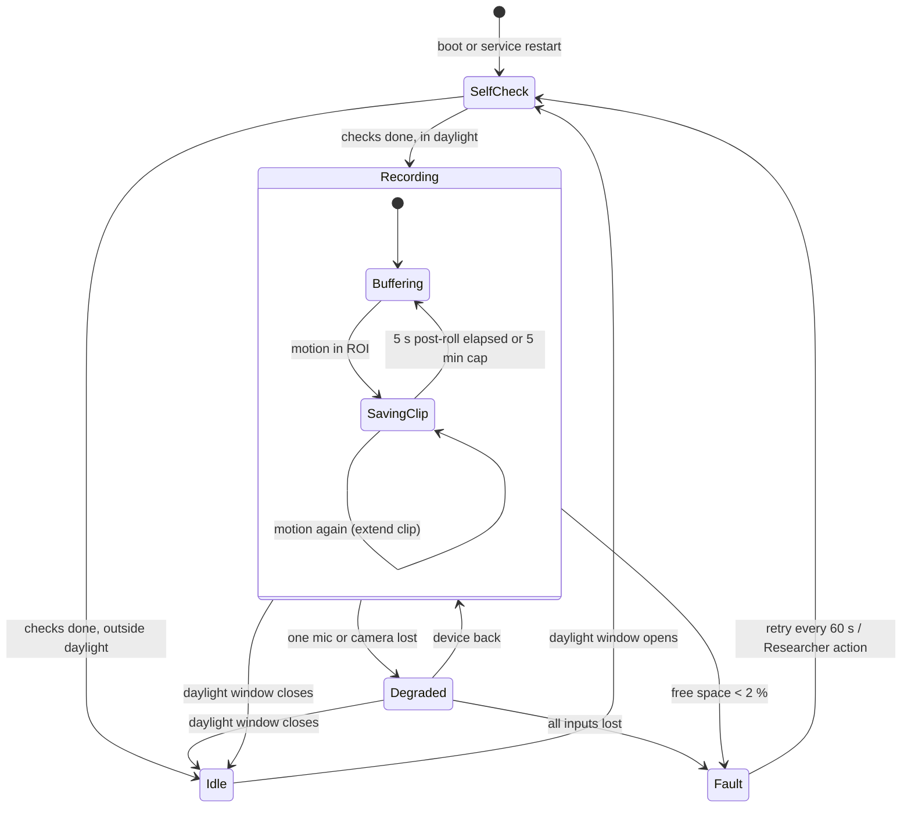

# State diagram — capture-rig — rig lifecycle

> **Feature**: capture-rig (brick C1) · **Spec**: [capture-rig](../../specs/capture-rig.md)

## Diagram

## Notes

- *Degraded* follows the daylight window like *Recording*; the next window opens through
  *SelfCheck* again (*Idle* → *SelfCheck*), which re-detects a still-missing device and
  re-enters *Degraded*.
- *Degraded* keeps recording the remaining streams (spec A2, A3); the gap goes in the sidecars.
- Audio streams continuously in both *Buffering* and *SavingClip*.
- *motion in ROI* is read at the next tick (1 s + the tick's work after the motion) and a clip
  starts on a keyframe (one per second); the ring holds the 5 s pre-roll plus a 3 s margin for
  both, so *SavingClip* starts ≥ 5 s before the first motion frame while a tick's work stays under
  about 0.9 s (spec AC7, #174).
- Power loss or a process exit from any state restarts at *SelfCheck* (spec A5): the systemd
  unit `deploy/systemd/aristech-record.service` starts the recorder at boot and restarts it
  10 s after any exit (see [05-deployment](05-deployment.md)).
