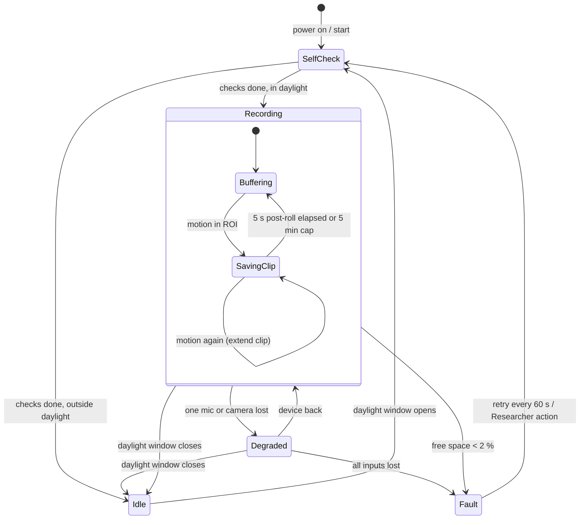

# State diagram — capture-rig — rig lifecycle

> **Feature**: capture-rig (brick C1) · **Spec**: [capture-rig](../../specs/capture-rig.md)

## Diagram

## Notes

- *Degraded* follows the daylight window like *Recording*; the next window opens through
  *SelfCheck* again (*Idle* → *SelfCheck*), which re-detects a still-missing device and
  re-enters *Degraded*.
- *Degraded* keeps recording the remaining streams (spec A2, A3); the gap goes in the sidecars.
- Audio streams continuously in both *Buffering* and *SavingClip*.
- Power loss from any state restarts at *SelfCheck* (spec A5).
