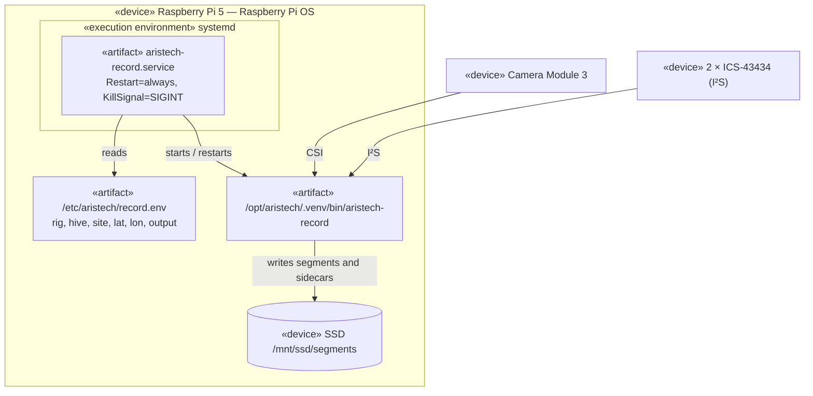

# Deployment diagram — capture-rig — recorder service on the Pi 5

> **Feature**: capture-rig (brick C1) · **Spec**: [capture-rig](../../specs/capture-rig.md) ·
> **Related ADRs**: ADR-0017

## Context

The recorder runs unattended for days (bench BA7) and must come back by itself after a power
loss (spec A5, bench BA10). systemd owns its lifecycle: it starts it at boot once the SSD is
mounted and restarts it after any exit; per-rig settings come from an env file outside git.

## Diagram

## Notes

- `RequiresMountsFor=/mnt/ssd`: the recorder never writes to the SD card if the SSD is missing.
- `StartLimitIntervalSec=0`: systemd never stops restarting it.
- The unit and the env example are checked by `tests/unit/interface/test_record_service_unit.py`.
