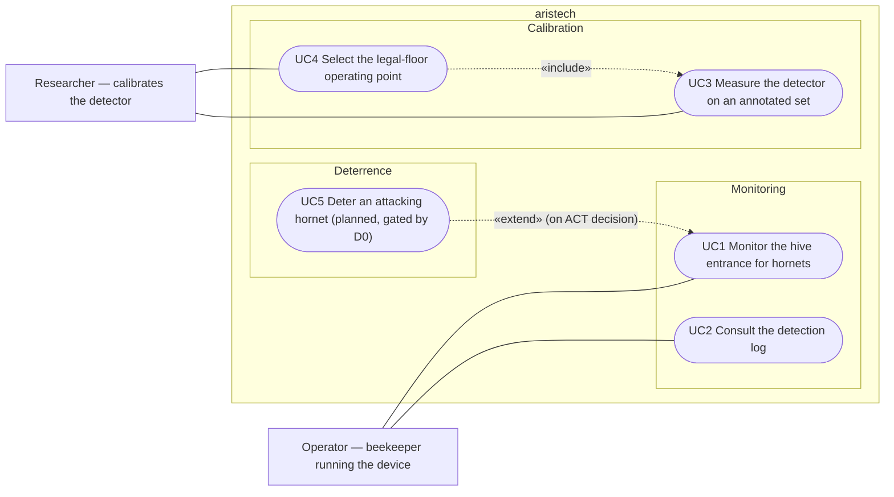

# Use-case diagram — detection — as-built visual detection (v1)

> **Feature**: detection v1 (M0–M4, `docs/ROADMAP.md`)
> **Source specs**: `docs/requirements.md` (detection decisions)
> **Related ADRs**: ADR-0002, ADR-0003, ADR-0004, ADR-0005, ADR-0006

## Context

Who uses the detection system today, and to do what. Drawn as-built (brick B1) from the code on
`main`; planned goals are marked. Does not cover how the goals are implemented (see the component
diagram).

## Diagram

## Notes

- UC1 — shipped: `python -m aristech --video … --weights … --yolov5-dir …`. Main scenario: open
  the source, detect per frame, decide, log each ACT detection. Extensions: missing weights or
  source → exit code 2; camera index vs file path resolved by the CLI.
- UC2 — shipped as a structured log (`LoggingNotifier`), no dedicated viewer (ADR-0006).
- UC3 / UC4 — shipped: `evaluate_on_dataset`, `scripts/measure_operating_point.py` (M3, M4).
- UC5 — not implemented; no actuator before a positive D0 (ADR-0005).
