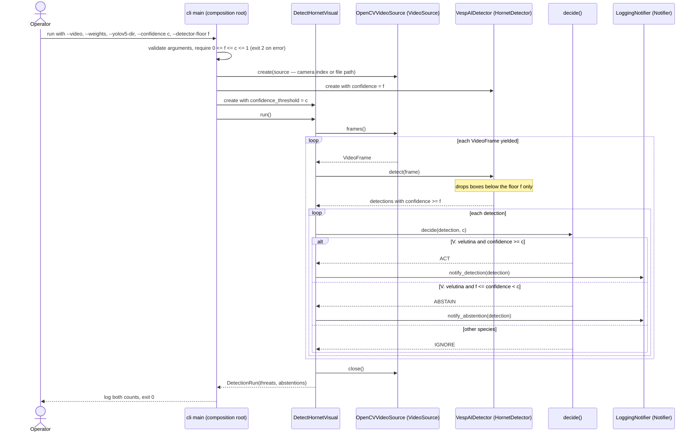

# Sequence diagram — detection — UC1 live detection loop

> **Feature**: detection v1
> **Source**: `src/aristech/interface/cli/main.py`, `src/aristech/application/use_cases/detect_hornet_visual.py`,
> `src/aristech/application/decision.py`
> **Related ADRs**: ADR-0001, ADR-0003, ADR-0004, ADR-0009
> **Spec**: `docs/architecture/specs/live-abstain.md`

## Context

What happens in time when the operator runs UC1. Since brick B4 (ADR-0009) the detector runs at a
low floor `f` and only `decide()` applies the operating threshold `c`, so uncertain targets are
reported as abstentions instead of vanishing (audit M3, now fixed).

## Diagram

## Notes

- `--detector-floor` defaults to 0.1, lowered to `c` when `c < 0.1`.
- Other species are never reported, neither as threat nor as abstention (legal floor, ADR-0003).
- `close()` runs in a `finally`, also on detector errors.
