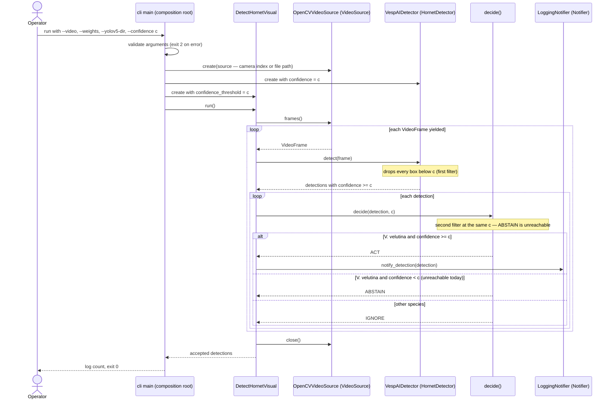

# Sequence diagram — detection — UC1 live detection loop (as-built)

> **Feature**: detection v1
> **Source**: `src/aristech/interface/cli/main.py`, `src/aristech/application/use_cases/detect_hornet_visual.py`,
> `src/aristech/application/decision.py`
> **Related ADRs**: ADR-0001, ADR-0003, ADR-0004

## Context

What happens in time when the operator runs UC1. Drawn as-built to make the double confidence
filter visible (audit finding M3), which brick B4 fixes.

## Diagram

## Notes

- The ABSTAIN branch of `decide()` exists and is unit-tested, but never fires in the live path
  because the detector already dropped every box below `c` (audit M3, ADR-0004 consequences).
- Fix direction for B4: the detector runs at a low floor and only `decide()` applies the
  operating threshold, so uncertain targets are visible as ABSTAIN.
- `close()` runs in a `finally`, also on detector errors.
