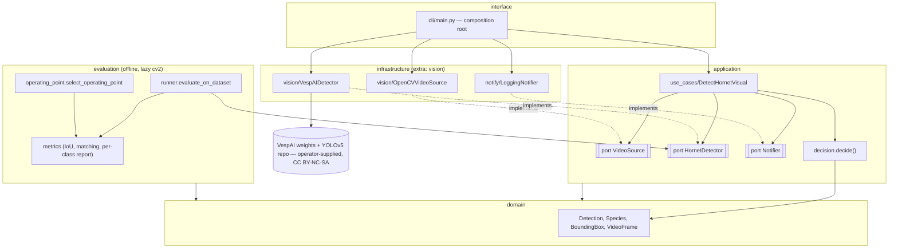

# Component diagram — detection — layers and ports (as-built)

> **Feature**: detection v1
> **Related ADRs**: ADR-0001, ADR-0002, ADR-0006

## Context

Structural boundaries of the detection path and the offline evaluation, with the dependency rule
(arrows point to what a component depends on). Speculative ports with no consumer (audit S1) were
removed in brick B5 (ADR-0010).

## Diagram

## Notes

- `domain/` imports nothing outside itself; `application/` imports only `domain/`; torch, cv2 and
  YOLOv5 stay in `infrastructure/` or behind a lazy import (`evaluation/runner.py`).
- `HornetDetector` has two consumers (live use case, offline evaluation): the force that
  justifies the port.
- The legacy Keras `training/` package was removed in B5 (ADR-0010). Its generic file splitter
  survives as `aristech.datasets.distribute`, a stdlib-only helper used by the dataset scripts,
  outside the detection path.
