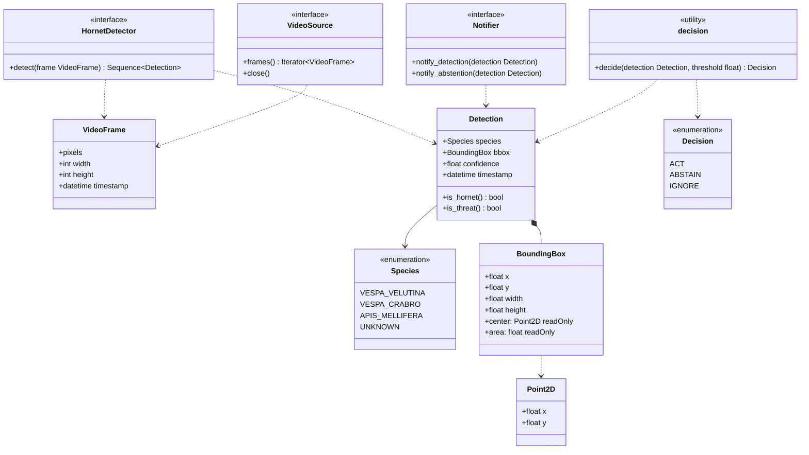

# Class diagram — detection — domain and decision types (as-built)

> **Feature**: detection v1
> **Source**: `src/aristech/domain/`, `src/aristech/application/decision.py`,
> `src/aristech/application/ports/`
> **Related ADRs**: ADR-0003, ADR-0004

## Context

The entities exchanged on the detection path and the decision vocabulary. Types used only by the
speculative ports (`Target`, `Point3D`, `AudioSample`) were removed in B5 (ADR-0010).

## Diagram

## Notes

- All domain types are frozen dataclasses; `Detection` rejects a confidence outside [0, 1].
- `is_threat()` is true only for *V. velutina*; `is_hornet()` also includes *V. crabro*, which is
  never acted upon (`decide()` returns IGNORE).
- `decide()` is a pure function in `application/`; moving it to `domain/` is an audit Nice (N1).
- No state diagram: `Decision` is a stateless mapping, no object has a lifecycle on this path.
- No data-flow diagram: the path processes no personal data.
