# State diagram — health-push — fault rate limit per fault kind

> **Feature**: health-push (issue #158) · **Spec**: [health-push](../../specs/health-push.md) ·
> **ADRs**: ADR-0033

## Diagram

```mermaid
stateDiagram-v2
    [*] --> Open
    Open --> Muted: fault(kind) / notify_fault(suppressed = muted count); last := now; muted := 0
    Muted --> Muted: fault(kind) [now - last < cool-down] / muted += 1 (logged, not pushed)
    Muted --> Open: [now - last ≥ cool-down]
```

## Notes

- One machine per `FaultKind` (`loop_error`, `source_ended`); kinds never mute each other (AC4).
- The heartbeat has no state beyond its next due time: `tick` returns one when `now ≥ due`, then
  `due := now + period` (AC1).
- Implemented by `application/health.py` (`HealthMonitor`); time from the injected `Clock`.
