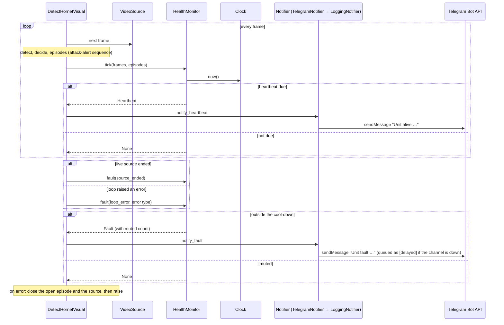

# Sequence diagram — health-push — heartbeat and faults in the live loop

> **Feature**: health-push (issue #158) · **Spec**: [health-push](../../specs/health-push.md) ·
> **ADRs**: ADR-0032, ADR-0033

## Diagram

## Notes

- The clock is the wall clock, never the video time (AC1); a hung source stops the heartbeat,
  which is the signal (A4).
