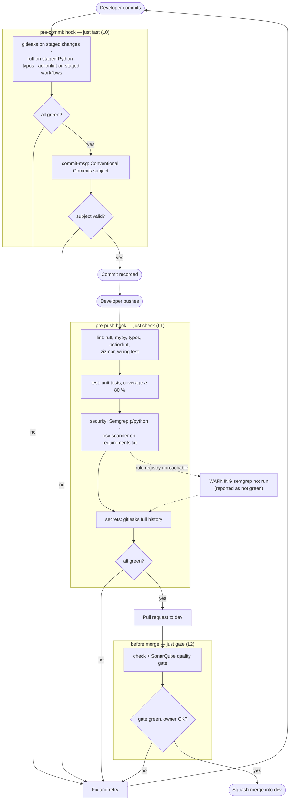

# Activity diagram — local CI — from a commit to a merge into `dev`

> **Feature**: local CI tiers (ADR-0027, issue #109)
> **Related ADRs**: ADR-0027, ADR-0025 (promotion model), ADR-0026 (frozen environment records)

## Context

Which checks run on the developer machine, when, and what stops the flow. It details the "Developer
machine (local CI)" partition of [`promotion/01-activity.md`](../promotion/01-activity.md). The
partitions are the git hooks and the manual pre-merge step, not components.

## Diagram

## Notes

- Semgrep offline is the only skip: it prints a warning and the pre-merge review reports the step
  as not green (ADR-0027 D2).
- The frozen environment records under `docs/research/` are outside the osv-scanner scan.
