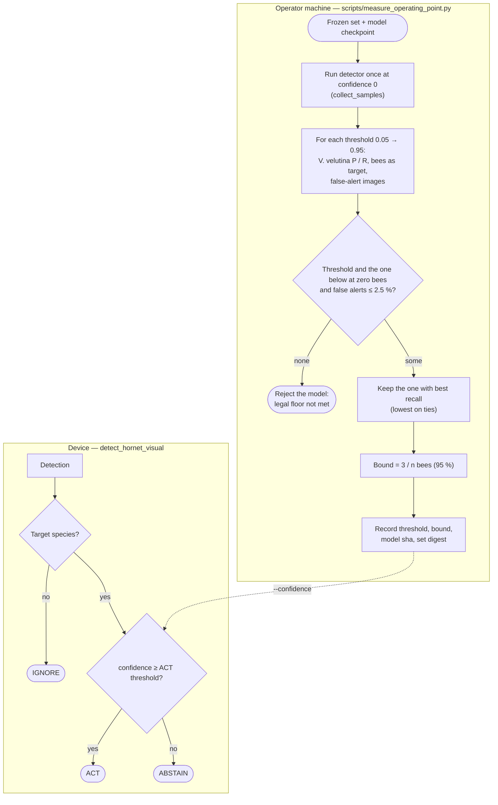

# Activity diagram — operating point — measuring the ACT threshold

> **Feature**: M4 operating point (issue #18)
> **Related ADRs**: ADR-0014 (two operating points), ADR-0029 (margin and bound), ADR-0009 (abstain)

## Context

How the ACT threshold is measured offline on a frozen set and then used live. The detector runs once
at confidence 0; every candidate threshold is scored on the same samples. Partitions are where the
work happens.

## Diagram

## Notes

- ACT is the only outcome that may drive an actuator (ADR-0014); in v1 it raises the hornet alert.
- On test-v1 with RF-DETR Small the rule gives 0.45 (`docs/research/operating-point-test-v1.md`).
- The threshold is provisional until the field set (M5) is measured.
- The COUNT point (ADR-0031) is measured after ACT by the same script: the lowest threshold with
  image precision ≥ 0.80, rejected if above ACT; it feeds the attack episodes
  ([attack-alert](../attack-alert/01-state.md)).
