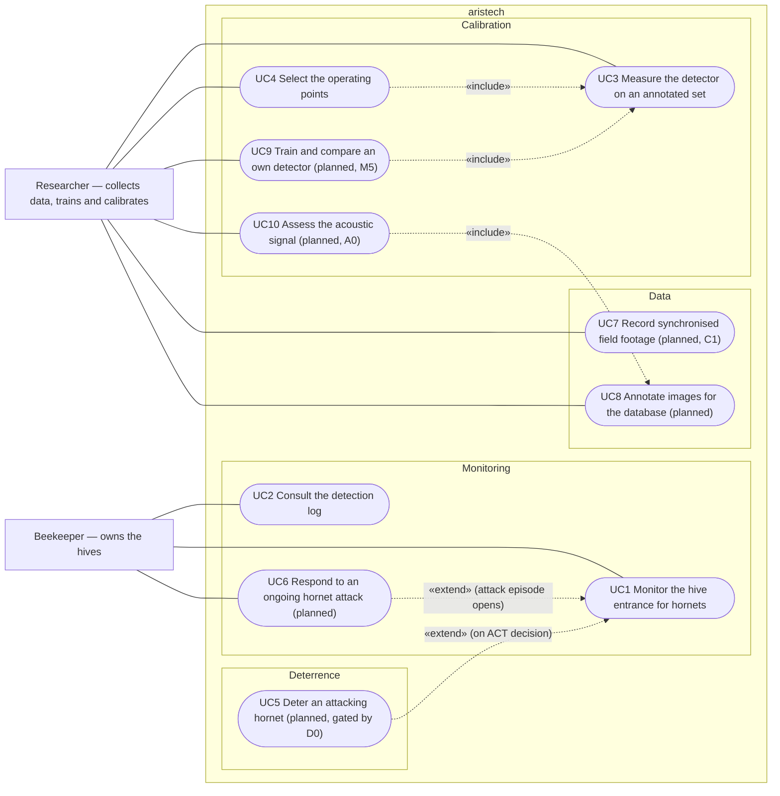

# Use-case diagram — product — target goals after the needs brainstorm

> **Feature**: product scope re-targeted 2026-10-16
> **Source specs**: `attack-alert`, `capture-rig`, `own-vision-model`, `acoustic-feasibility`,
> `deterrence-field-test`; `docs/requirements.md`
> **Related ADRs**: ADR-0003, ADR-0005, ADR-0013, ADR-0014, ADR-0015, ADR-0016

## Context

The target set of actor goals, extending the as-built detection diagram
(`../detection/01-use-case.md`, UC1–UC5). Planned goals are marked. Grouped by domain, not by
component.

## Diagram

## Notes

- The detection diagram calls the beekeeper "Operator"; same actor.
- UC4 now selects **two** points (ACT, COUNT — ADR-0014); the as-built one selects ACT only.
- UC6 is the beekeeper's goal (react to the attack); the alert is its trigger, not a use case.
- D0 is a manual field protocol (spec `deterrence-field-test`), not a system use case; it gates UC5.
- UC10's outcome may add an acoustic input to UC1; it can only reinforce abstention (ADR-0016).
