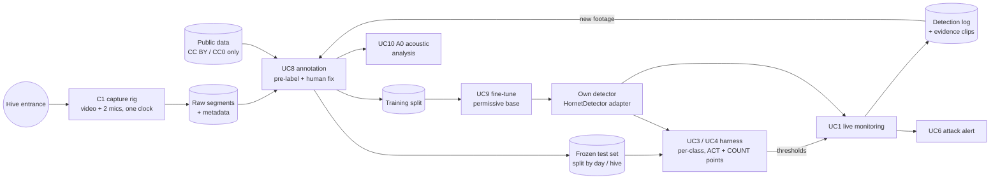

# Data-flow diagram — product — the field-data flywheel

> **Feature**: product scope re-targeted 2026-10-16
> **Source specs**: `capture-rig`, `own-vision-model`, `acoustic-feasibility`, `attack-alert`
> **Related ADRs**: ADR-0013, ADR-0014, ADR-0015, ADR-0016

## Context

How field recordings become the own model and the operating points, and how the deployed model
feeds back new footage. Planned flows; nothing here is implemented yet.

## Diagram

## Notes

- The frozen test set never feeds training; it is versioned and only grows by explicit decision.
- Every item in Public carries its licence; NC sources are excluded (ADR-0015).
- VespAI is evaluated on the same frozen set as the baseline.
