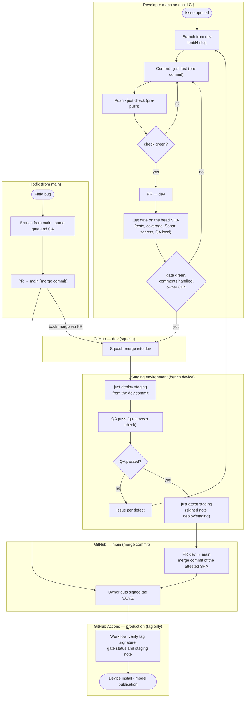

# Activity diagram — promotion — from a branch to the field

> **Feature**: branching and promotion model (ADR-0025, issue #112)
> **Related ADRs**: ADR-0025, ADR-0008 (method), ADR-0017 (bench device)

## Context

How a change travels from a developer's branch to a device at the apiary: which checks run where,
and which steps are local (`just`) versus GitHub (one workflow, on the signed tag). The partitions
(Mermaid subgraphs, standing in for UML activity partitions) are the places where the work happens,
not components.

## Diagram

## Notes

- Until the bench device exists (ADR-0017), the "Staging" partition is replaced by `just gate` run
  locally; `just deploy staging` and `just attest staging` arrive with the device.
- The production workflow is a sketch: aristech has no device install nor model publication job
  yet. The tag already marks the field-ready version.
- The attestations (`gate` commit status, `deploy/staging` signed note) are the cross-project
  tooling of agents-skills#210, bricks 3 and 5; until then the PR review and the owner's approval
  stand in for them.
- A hotfix follows the same tag path as a release; its back-merge into `dev` is a merge-commit
  pull request, since `dev` refuses direct pushes.
